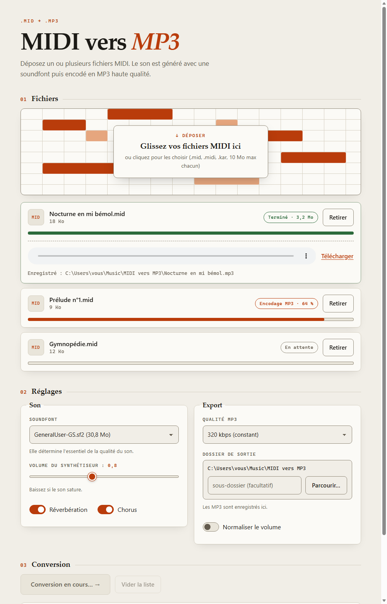

# MIDI vers MP3

Convertissez vos fichiers MIDI en MP3 de haute qualité depuis votre navigateur. Tout se passe sur votre ordinateur : aucun fichier n'est envoyé sur Internet.



- Dépôt de **plusieurs fichiers** à la fois, traités à la suite
- **Barre de progression réelle** par fichier et pour toute la liste (synthèse puis encodage)
- **Écoute directe** dans la page, avec déplacement dans le morceau, et téléchargement
- **Dossier de sortie au choix** (sélecteur intégré, création de dossier, sous-dossier facultatif)
- Qualité MP3 réglable (320, 256, 192 kbps ou VBR V0), volume, réverbération, chorus, normalisation
- Thèmes clair et sombre automatiques, utilisable au clavier

Le son est produit par [FluidSynth](https://www.fluidsynth.org/) avec une *soundfont* (banque d'instruments), puis encodé par [FFmpeg](https://ffmpeg.org/). **La soundfont détermine l'essentiel de la qualité du son.**

---

## Installation sous Windows (le plus simple)

1. Téléchargez `MIDI-vers-MP3-windows.zip` dans la page [Releases](../../releases) du dépôt, puis dézippez-le.
2. Double-cliquez sur **`installer-dependances.bat`** : il installe FFmpeg, FluidSynth et une soundfont (GeneralUser GS). Pas de droits administrateur nécessaires. À faire **une seule fois**.
3. Double-cliquez sur **`MIDI-vers-MP3.exe`** : une fenêtre noire s'ouvre, puis votre navigateur affiche l'application. Pour arrêter, fermez la fenêtre noire.

Les MP3 vont par défaut dans `Musique\MIDI vers MP3`. Le bouton **Parcourir…** permet de choisir un autre dossier.

> **Windows affiche « Windows a protégé votre ordinateur » ?** L'exécutable n'est pas signé numériquement. Cliquez sur *Informations complémentaires*, puis *Exécuter quand même*. Vous pouvez vérifier le zip avec l'empreinte SHA256 publiée dans la Release, ou construire l'exécutable vous-même (voir plus bas).

## Installation depuis les sources (Windows, macOS, Linux)

Prérequis : Python 3.9 ou plus récent, FluidSynth et FFmpeg dans le `PATH`, et au moins une soundfont `.sf2` ou `.sf3`.

| Système | Installer FluidSynth et FFmpeg |
|---|---|
| Windows | `windows\installer-dependances.bat` (installe aussi la soundfont) |
| Debian / Ubuntu | `sudo apt install fluidsynth ffmpeg` |
| macOS | `brew install fluid-synth ffmpeg` |

Posez une soundfont dans le dossier `soundfonts/` du projet, ou dans `~/soundfonts`. Sous Linux et macOS, vous pouvez par exemple télécharger [GeneralUser GS](https://github.com/mrbumpy409/GeneralUser-GS).

```bash
git clone https://github.com/patntiwa/midi-to-mp3.git
cd midi-to-mp3
pip install -r requirements.txt
python app.py
```

Le navigateur s'ouvre sur http://127.0.0.1:5000. Sous Windows, `lancer.bat` fait la même chose d'un double-clic.

Options de `python app.py` :

| Option | Effet |
|---|---|
| `--output-dir "D:\Musique\MP3"` | dossier racine des MP3 (défaut : `./output`, ou `Musique\MIDI vers MP3` dans l'exécutable) |
| `--port 5000` | port souhaité ; si occupé, le suivant libre est pris |
| `--no-browser` | n'ouvre pas le navigateur |
| `--host 0.0.0.0` | accessible depuis le réseau (voir *Sécurité*) |

## Utiliser l'application

1. **Fichiers** : glissez un ou plusieurs `.mid`, `.midi` ou `.kar` (10 Mo max chacun). Ils apparaissent sous la zone de dépôt.
2. **Réglages** : choisissez la soundfont, le volume, les effets, la qualité MP3 et le dossier de sortie. Dans la fenêtre **Parcourir…**, naviguez dans vos dossiers, remontez d'un niveau ou créez un dossier. Votre choix est mémorisé.
3. **Conversion** : cliquez sur **Convertir**. Chaque fichier a sa barre de progression et la liste entière a la sienne. Quand un fichier est terminé, écoutez-le directement ou téléchargez-le. Il est déjà enregistré dans le dossier choisi.

Si un nom existe déjà, le nouveau fichier devient `nom (2).mp3` : rien n'est jamais écrasé.

## Utiliser le moteur seul en ligne de commande

```bash
python midi2mp3.py morceau.mid
python midi2mp3.py ./dossier_midi -o ./dossier_mp3 --quality vbr --normalize
```

`python midi2mp3.py --help` liste toutes les options.

## Construire l'exécutable Windows

```powershell
powershell -ExecutionPolicy Bypass -File .\build_windows.ps1
```

Le script installe PyInstaller, lance les tests, construit `dist\MIDI-vers-MP3.exe` (environ 13 Mo) et assemble `dist\MIDI-vers-MP3-windows.zip` avec son empreinte SHA256.

## Comment ça marche

```
navigateur  ──POST /api/jobs──▶  serveur Flask  ──▶  FluidSynth (MIDI → WAV)  ──▶  FFmpeg (WAV → MP3)  ──▶  dossier choisi
     ▲                                │
     └── GET /api/jobs/<id> (progression) · GET /api/jobs/<id>/audio (écoute)
```

- **Progression mesurée, pas simulée** : la synthèse est suivie par la taille du WAV produit rapportée à la durée du MIDI (calculée avec sa carte des tempos), l'encodage par le `-progress` de FFmpeg. La synthèse compte pour 80 % du total.
- **API** : `/api/config`, `/api/soundfonts`, `POST /api/jobs`, `GET /api/jobs/<id>`, `GET /api/jobs/<id>/audio`, `/api/browse`, `POST /api/mkdir`.
- **Fichiers** : `app.py` (serveur), `index.html` (interface sans dépendance externe), `midi2mp3.py` (moteur), `test_app.py` (tests), `docs/specs/` (décisions de conception).

## Limites et sécurité

- 10 Mo par fichier, 2 conversions simultanées, 40 tâches en attente au plus, délai maximal de 180 s par étape.
- Le client choisit une soundfont par son nom uniquement, jamais par un chemin.
- Le sélecteur de dossier (qui permet d'écrire n'importe où sur l'ordinateur) n'est actif que si le serveur n'écoute qu'en local (`127.0.0.1`, le défaut). Avec `--host 0.0.0.0` il est désactivé et seule la racine `--output-dir` est utilisable. En mode local, toute requête dont l'hôte n'est pas `localhost` est refusée (protection contre le DNS rebinding), et les POST venant d'une autre origine aussi.
- Le sous-dossier est assaini (caractères interdits remplacés, `..` refusé) et reste toujours sous le dossier de sortie.
- Les fichiers intermédiaires sont créés dans un dossier temporaire supprimé aussitôt.
- **N'exposez pas ce serveur sur Internet tel quel** : ajoutez un serveur WSGI de production (waitress, gunicorn) derrière HTTPS, une authentification et une limitation de débit. Les tâches sont gardées en mémoire (6 h) : un seul processus.

## Dépannage

| Symptôme | Solution |
|---|---|
| « Outil(s) introuvable(s) : ffmpeg… » | Windows : relancez `installer-dependances.bat`. Sinon installez l'outil et vérifiez qu'il est dans le `PATH`. |
| Liste de soundfonts vide | Placez un `.sf2` dans `soundfonts/` ou `%USERPROFILE%\soundfonts`, puis rechargez la page. |
| Le navigateur ne s'ouvre pas | Ouvrez l'adresse affichée dans la fenêtre noire. |
| « Port occupé » | Rien à faire : le port suivant libre est pris et affiché. |
| Son saturé | Baissez le volume du synthétiseur. |

## Tests

```bash
python -m unittest -v
```

Le test de bout en bout utilise FluidSynth, FFmpeg et une soundfont s'ils sont présents, et il est ignoré sinon.

## Licence

[MIT](LICENSE). Les composants tiers (FluidSynth, FFmpeg, soundfont, bibliothèques Python) ont leurs propres licences : voir [THIRD_PARTY_NOTICES.md](THIRD_PARTY_NOTICES.md). Vérifiez la licence de la soundfont que vous utilisez.

---

## English summary

**MIDI to MP3** is a local web app that converts MIDI files to high quality MP3 using FluidSynth and FFmpeg. Drop several files, watch real progress bars, play the result in the page, and save it to any folder you pick. Nothing leaves your computer.

- **Windows**: download `MIDI-vers-MP3-windows.zip` from [Releases](../../releases), run `installer-dependances.bat` once (installs FFmpeg, FluidSynth and a soundfont, no admin rights), then run `MIDI-vers-MP3.exe`.
- **From source** (any OS): install Python 3.9+, FluidSynth, FFmpeg and a `.sf2` soundfont, then `pip install -r requirements.txt && python app.py`.
- Tests: `python -m unittest -v`. License: MIT. The interface is in French.
